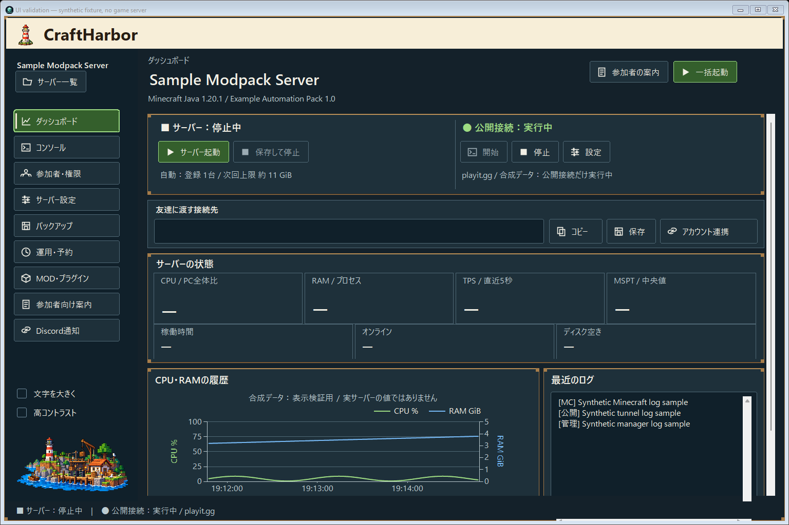

# 採用デザインとの比較 — 2026-10-25

前回の実装は配色を合わせることが中心で、採用画像のアイコン、文字の強弱、密度、木枠、港の装飾が十分に再現できていませんでした。この改修では実際のコントロールと共通描画部品を変更しました。

## 同じサイズでの変更前後

採用画像と同じ **1536×1024** のウィンドウで比較しています。以下はクラウドのWindows CIで描画したアプリです。サーバー名・接続先・ログ・グラフは表示検証用の合成データで、本番画面は既存の実データを表示します。

### 改修前

### 改修後

## 採用画像を基準にした評価

| 比較項目 | 改修前の不足 | 今回の対応 |
| --- | --- | --- |
| クリーム色のヘッダー・灯台・ロゴ | 通常書体のロゴで印象が異なる | ピクセル描画のロゴに変更。灯台とクリーム色を維持 |
| サイドバー | 単色の小さいアイコン、文字が弱い | 30pxの生成アイコン、13.5ptの太字、枠と選択マーカー。通常サイズは9項目が収まるよう調整 |
| サーバーと公開接続 | 採用画像の象徴的なイラストがない | 草ブロックと港のイラストを個別に配置。稼働状態と操作可否は独立したまま |
| 木枠 | 茶色の線だけに近い | 明暗・短い木目・ピクセル形状の金具を共通描画 |
| サーバー名・情報階層 | 小さい見出しに対して余白が大きい | 27ptのサーバー名、13.5ptのメタ情報、16ptのセクション見出し |
| 接続先 | ラベルと入力欄で2段を占有 | 広い画面ではラベル・入力・コピー・保存・連携を横一列に |
| メトリクス | 空白が大きい7枚のカード | 4つの主要値と3つの補助値に強弱をつけ、アイコンを追加。狭い画面は折り返す |
| グラフと最近のログ | 同じ1536×1024でも下部が切れる | 残りの高さを割り当て、グラフ・ログ・補助操作まで表示。状態は専用ラベルで明示 |
| 左下の港 | 横長で小さい | 灯台・小屋・クレーン・水面の独立した透過素材を生成 |
| アプリ/配布アイコン | 別のロゴが残る | 同じ灯台から16〜256pxの7サイズのICOをビルドし、アプリ・setup・uninstallで共有 |

## 生成素材

24種類のアイコンを透過アトラスとして生成し、ネイティブ描画で必要な領域を選んで表示しています。UI画像を背景として貼ったものではありません。入力・ボタン・一覧・グラフは操作可能なコントロールです。

- [24種類のアイコン](../assets/harbor-icons.png)
- [灯台と港の装飾](../assets/harbor-tall.png)
- [素材の出典と扱い](../assets/ARTWORK.md)

## 意図的に異なる部分・検証の限界

- Windows標準のタイトルバーを残しています。採用画像の単一ヘッダーとは異なりますが、OS標準の移動・サイズ変更・最大化・最小化を維持します。
- 生成した絵とロゴは採用画像の方向性に合わせた独立素材です。ピクセル単位の同一性を主張するものではありません。
- 通常の本文・入力・数値・グラフは可読性を優先した書体で、12pt以上を維持します。
- ライブラリやOS互換性の制限は設計条件から外しました。今回の差分は共通描画とレイアウトの変更で実現できるため、ランタイムの移行や依存ライブラリの追加は行っていません。
- 物理モニターの高DPI切替、複数モニター移動、スクリーンリーダー、実Minecraftの接続は今回のクラウド検証の対象外です。

ビルド・機能チェック・実描画の証拠と正確な検証範囲は [UI_VERIFICATION.md](UI_VERIFICATION.md) に記録しています。ユーザーのPCでのアプリ操作やインストールは行っていません。
