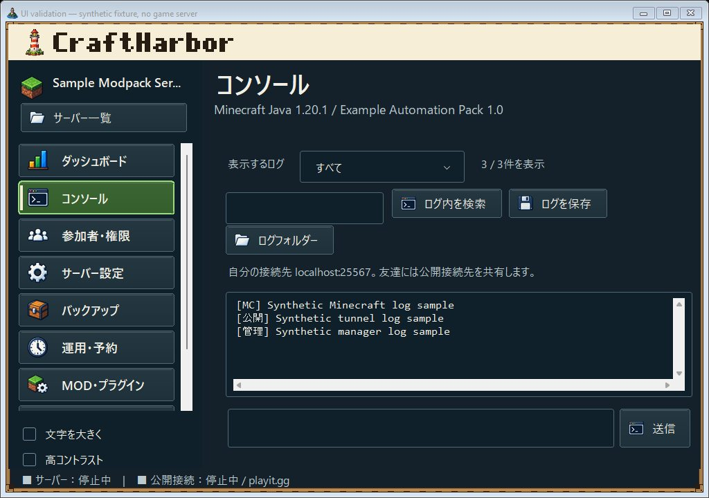
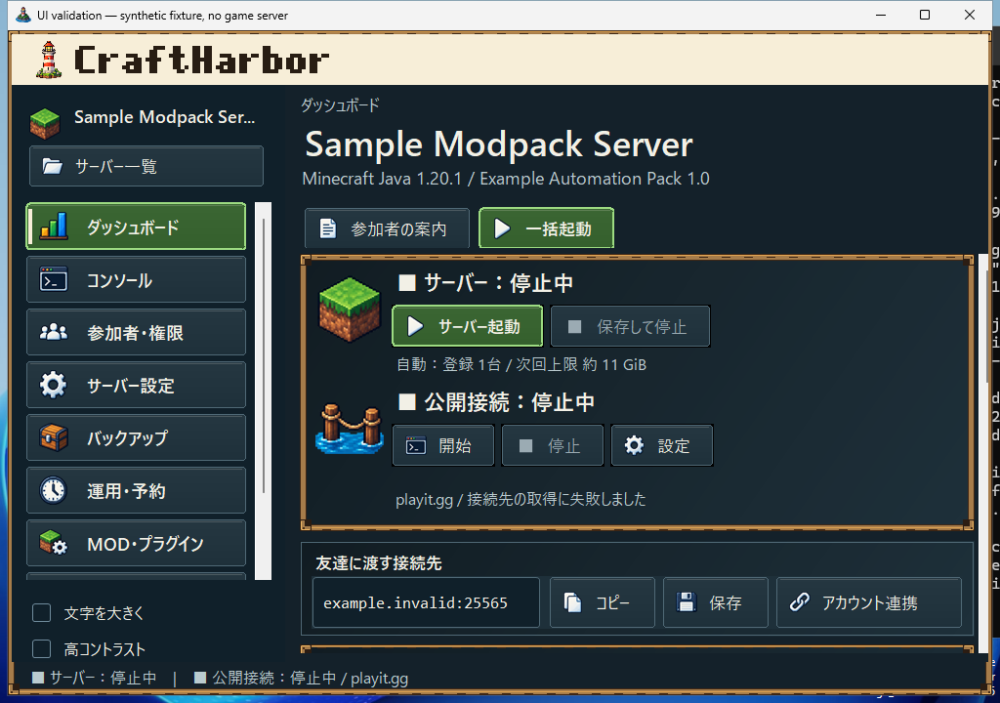
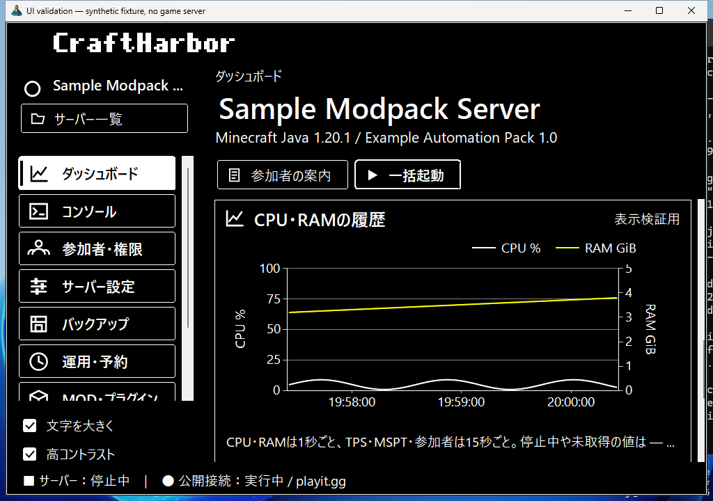

# Approved harbor UI: cloud verification

The current implementation uses C#, Windows Forms and .NET Framework 4.8. Modern dependencies and dropping older OS support are permitted; this visual revision does not require a runtime migration. Work used GitHub's repository API and GitHub-hosted Windows CI; the owner's PC, installed app, running server and connected devices were not accessed.

## Scope and visual review

The approved design supersedes the former mint palette. Shared native controls now provide a cream masthead, embedded lighthouse/harbor artwork, navy panels, green primary/selected buttons, layered wooden rails, pixel wordmark, generated 24-icon atlas, taller harbor artwork and visible selection/focus markers. Nine pages and the server-list, hosting and URL-import dialogs use the common treatment. The schedule time field uses native numeric inputs so it also follows the theme. The seven-size lighthouse ICO is shared by the app, setup and uninstall launcher. See [the approved-reference comparison](UI_COMPARISON.md) for same-size before/after captures and remaining visual differences.

The dashboard shows independent game/public states, the configured provider, address sharing, four main metrics and three secondary values, existing CPU/RAM history, and the last ten records from the console's bounded history. At narrow widths, the graph and recent logs stack and the page scrolls; forms wrap and table pages retain a minimum usable list area. Selecting a page reveals its navigation item.

All screenshots contain isolated fixtures. Server names, endpoints, logs and plotted samples shown in test captures are explicitly synthetic; production controls use existing runtime data.

## Screenshots

Captured from application source revision `eb4c3b4bf5137aae3cbe5f6a544cb428758c8623` in [Windows CI](https://github.com/g-kari/craftharbor/actions/runs/40127741012). Later documentation/evidence commits do not change application rendering; [the PR checks](https://github.com/g-kari/craftharbor/pull/1/checks) verify the final branch. The full artifact includes the remaining pages and dialog captures.

## Checks

| Check | Result |
| --- | --- |
| tools/build.ps1, app and persistent host | Windows CI passed |
| Offline core checks | Passed |
| tools/check-integrations.ps1 | Passed; fake child retained its PID while UI closed/reopened, reattached, accepted commands and stopped gracefully |
| tools/check-java.ps1 | Java 17 accepted the computed low-memory test options |
| tools/check-ui.ps1: vanilla, modpack, argfile | Passed |
| Reference-size dashboard at 1536×1024 | All nine navigation entries fit, complete address action labels, visible history-state badge and bottom graph/log actions fit asserted |
| Primary-button hover contrast | Brightest hover highlight is 5.36:1; minimum 4.5:1 asserted |
| Nine pages at 1360×960 and 1024×720 | Native DrawToBitmap captures reviewed; actual dimensions asserted |
| Nine pages at 1024×720 with large text + high contrast | Captured; minimum 12pt and enlarged chart legend asserted |
| Server stopped / public connection running | Separate enabled states and provider display asserted for all 4 providers × 4 running-state combinations |
| Preparing, starting, saving/stopping, failed address lookup, empty recent logs | Checked with isolated state fixtures |
| Console filtering and dashboard recent logs | Shared buffer and filter independence passed |
| Nine navigation buttons, Alt+9, Ctrl+L, F1, Tab order | Routing/selectability checks passed; physical foreground keystrokes were not exercised |
| Graph rollover and stale/stopped values | Existing 300-point/five-minute window, sample gaps and historical/stopped label checks passed |
| Setup, uninstall and data retention | Isolated CI installation passed; synthetic world/settings retained after uninstall |

Text contrast ratios are 14.35:1 on the workspace, 11.94:1 on panels, 6.52:1 on primary buttons, 5.36:1 at the brightest primary hover highlight, and 8.16:1 for muted text on panels (WCAG relative-luminance calculation).

## Limits

Physical high-DPI and multi-monitor transitions, assistive-technology output, foreground native keyboard delivery, interactive minimize/maximize/drag behavior, and an actual Minecraft/public-tunnel session are not verified by these fixtures. Existing DPI mode, native window controls, keyboard handlers, dialog Escape handling, and server lifecycle/storage code are retained. No update was installed on the owner's PC.

DrawToBitmap is off-screen native control rendering, not a photograph of a physical display. Hosted-desktop captures are also included for the narrow dashboard and the enlarged/high-contrast graph. They use a fresh GitHub Windows runner's screen, not the owner's PC. The off-screen DrawToBitmap view can omit surrounding controls after scrolling; the hosted-desktop capture confirmed those controls remain visible. Full lossless screenshot sets, check reports, setup.exe and the portable build are in the CI artifact. Completed job logs also expose lossless native PNGs for all nine normal and enlarged/high-contrast pages and the dialogs. Downloads from an active job can be incomplete; review the completed job output. The console image in this document is a JPEG preview; the original PNG is in the artifact. 
